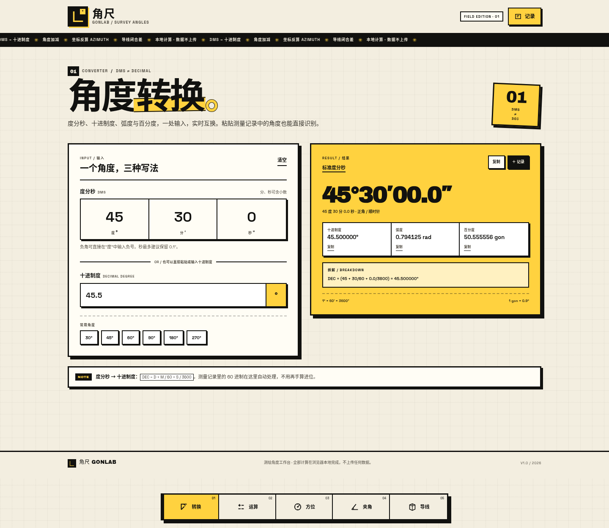
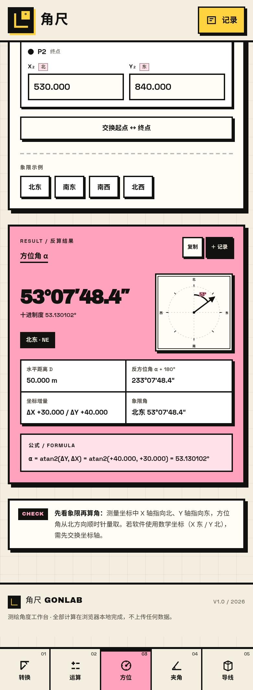

# 角尺 GONLAB

> 测绘角度工作台 · A neo-brutalist angle toolkit for surveying.
> 原生 HTML + CSS + JavaScript，零依赖、零构建，打开即用。





## 快速开始

### 方式一：直接打开（离线可用）

双击根目录的 `index.html`。所有脚本、样式和字体均在本地，不需要联网；不依赖 npm、Vite 或任何框架。

### 方式二：本地服务器（推荐，剪贴板权限更完整）

```bash
cd gonlab
python3 -m http.server 8080
```

然后访问 <http://localhost:8080>。

> 在 `file://` 协议下，部分浏览器会限制 `navigator.clipboard`。应用已带 `execCommand` 回退，但通过本地服务器打开复制更稳定。

## 功能

| # | 工具 | 说明 |
|---|------|------|
| 01 | **角度转换** | 度分秒 ⇄ 十进制度，实时联动；同时输出弧度、百分度（gon）。可粘贴 `45°30′15″`、`45 30 15`、`45:30:15`。 |
| 02 | **角度运算** | 两个角相加 / 相减，自动处理 60 进制与 0°–360° 归一化，可查看原始值与归一化值。 |
| 03 | **坐标方位角** | 由两点坐标或 ΔX / ΔY 反算方位角、水平距离、反方位角、象限角，带动态罗盘示意图。 |
| 04 | **夹角计算** | 输入两个方位角，或 A（后视点）/ O（测站点）/ B（前视点）三点坐标，求顺时针右角、逆时针左角、较小夹角与较大夹角。 |
| 05 | **导线角度闭合差** | 计算闭合多边形内角和、角度闭合差 fβ、容许闭合差 ±t√n、平均改正数及改正后角度；支持 3–20 个角。 |

### 其它细节

- **移动端优先**：底部五栏导航，输入框使用数字键盘，触控目标不小于约 40px，安全区适配。
- **本地记录**：每个结果卡右上角「＋ 记录」可保存结果；记录存储在 `localStorage`，不上传。
- **复制**：度分秒、十进制度、弧度、gon、改正表都可以一键复制。
- **深链**：`#convert`、`#ops`、`#azimuth`、`#included`、`#traverse` 可直接打开对应工具。
- **无外部请求**：不加载 CDN、不发送计算数据、不做统计上报。
- **无障碍基础**：语义化表单标签、键盘焦点样式、`aria-live` 结果区、原生 `<dialog>` 记录面板、`prefers-reduced-motion` 适配。

## 坐标与角度约定

- 使用中国测绘常用**测量坐标系**：`X = 北方向`，`Y = 东方向`。
- 方位角 `α` 自北方向起算，**顺时针** 0°–360°。
- 象限角为方向线与最近北/南方向之间的锐角，并带象限名（北东、南东、南西、北西）。
- 坐标反算：

```text
ΔX = X₂ − X₁   （北向增量）
ΔY = Y₂ − Y₁   （东向增量）
α  = atan2(ΔY, ΔX) mod 360°
D  = √(ΔX² + ΔY²)
```

- 夹角计算中，**右角**定义为从 A 方向顺时针转到 B 方向：
  `右角 = (αB − αA + 360°) mod 360°`；左角为 `360° − 右角`。
- 若使用数学坐标（X 东 / Y 北），请先交换两轴，否则方位角会差 90° 的象限关系。

## 精度与计算口径

- 内部以十进制度参与双精度浮点计算；界面角度结果默认显示到 `0.1″`，十进制度显示 6 位小数。
- 度分秒输入允许分、秒暂时超过 60，计算时会自动进位。
- 导线闭合差：

```text
Σβ理论 = (n − 2) × 180°
fβ = Σβ观测 − Σβ理论
容许值 = ±t√n
每角改正 v = −fβ / n
```

- 内置容许值等级仅为常用工程测量口径，供快速检核：

| 等级 | 系数 t |
|------|--------|
| 图根 | ±40″ |
| 一级 | ±10″ |
| 二级 | ±16″ |
| 三级 | ±24″ |

> 实际项目应以技术设计书、现行规范和平差方案为准。本工具只做角度闭合的快速检核，不替代完整导线平差。

## 项目结构

```text
gonlab/
├── index.html                 # 单页应用全部结构
├── css/
│   └── style.css              # 新粗野主义设计系统 + 响应式布局
├── js/
│   ├── angle.js               # 纯计算核心（UMD，可在 Node 中测试）
│   └── app.js                 # 原生 DOM 交互、路由、记录、复制
├── assets/
│   ├── favicon.svg
│   └── fonts/
│       ├── archivo-black-latin.woff2
│       ├── space-grotesk-latin.woff2
│       └── SIL-OFL.txt        # 字体许可
├── screenshots/               # README 预览图
├── tests/
│   └── angle.test.js          # 计算核心回归测试
└── README.md
```

## 运行测试

无需安装依赖，使用 Node.js 内置的 `assert`：

```bash
node tests/angle.test.js
```

覆盖度分秒转换、舍入进位、方位角四象限、反方位角、夹角归一化、导线闭合差合格 / 超限等 11 组断言。

## 浏览器支持

面向现代浏览器构建，推荐：

- iOS Safari 15.4+
- Android Chrome / Edge 100+
- 桌面 Chrome / Edge / Firefox / Safari 最近版本

使用了原生 `<dialog>`、`dvh`、`env(safe-area-inset-bottom)`、`inputmode` 等现代 Web API。

## 设计说明

- 视觉：纸感米色底 + 黑色硬边框 + 4–7px 硬阴影，强调分明的工具感。
- 工具色：转换黄、运算青、方位粉、夹角绿、导线橙；每个页面只用一个高饱和强调色。
- 字体：Archivo Black（标题 / 数字）+ Space Grotesk（说明 / 数值）+ 系统中文字体回退。
- 所有图形（品牌角标、罗盘、射线、箭头）为内联 SVG，无图片依赖。

## 数据与隐私

计算全部在浏览器本地完成。记录只写入当前浏览器的 `localStorage`（键名 `gonlab.history.v1`），不会发送到服务器。清除浏览器站点数据会同时清除记录。

## 字体许可

`assets/fonts/` 内的 Archivo Black 与 Space Grotesk 均为 SIL Open Font License 1.1 字体，来源 Google Fonts。完整许可见 [`assets/fonts/SIL-OFL.txt`](assets/fonts/SIL-OFL.txt)。
